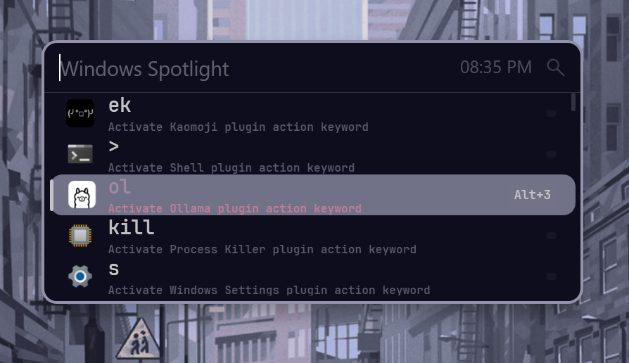

## Theme Configuration

### Pywal Theme

> ⚠️ Warning: Pywal integration is WIP. So , for now, it's a Static Theme.

The current theme is set to **Pywal**, a dynamic theming system that adapts to your Windows color scheme.

### Visual Customization

The XAML theme file (`flow_launcher.xaml`) defines custom styles for:

- Window borders with rounded corners (16px)
- Query input box with custom foreground colors
- Result items with selected/unselected states
- Preview panel for result details
- Glyph icons for visual identification

**Color Palette:**
- Background: `#0c0c1d` (dark)
- Text: `#c2c2c6` (light)
- Accent: `#7D8399` (muted)
- Selection: `#616579`

---

## Hotkey Configuration

### Primary Launch Hotkey

**`Alt + Space`** - Launch Flow Launcher

This is the default Windows search hotkey, making Flow Launcher easily accessible from anywhere in Windows.

### Navigation Hotkeys

| Hotkey        | Action               |
| ------------- | -------------------- |
| `Alt + ↑`     | Cycle history up     |
| `Alt + ↓`     | Cycle history down   |
| `Ctrl + O`    | Open context menu    |
| `Ctrl + I`    | Open settings window |
| `Ctrl + H`    | Open history         |
| `Alt + G`     | Dialog jump          |
| `F1`          | Preview result       |
| `Ctrl + Tab`  | Auto-complete        |
| `Shift + Tab` | Select previous item |

### Result Selection

- **Open Result Modifiers**: `Alt`
- **Show Open Result Hotkey**: Enabled

### Settings Window

- **Hotkey**: `Ctrl + I`
- **Font**: JetBrainsMonoNL NFP
- **Width**: 1011.2 px
- **Height**: 1092 px

---

## Plugin System

Flow Launcher supports a modular plugin architecture. The current configuration includes the following built-in plugins:

### Core Plugins

| Plugin               | Keywords                         | Description               |
| -------------------- | -------------------------------- | ------------------------- |
| **Calculator**       | `*`                              | Built-in calculator       |
| **Explorer**         | `doc:*`, `*`, `fldr`, `fl`, `qa` | File explorer integration |
| **Plugin Indicator** | `?`                              | Shows available plugins   |
| **Plugins Manager**  | `pm`                             | Manage plugins            |
| **Process Killer**   | `kill`                           | Kill running processes    |
| **Program**          | `*`                              | Launch programs           |
| **System Commands**  | `sys`                            | Execute system commands   |

### Custom Explorer Plugins

The `CustomExplorerList` defines additional file explorer integrations:

1. **Explorer** - Windows Explorer (`explorer`)
2. **Total Commander** - Third-party file manager
3. **Directory Opus** - Advanced file manager
4. **Files** - Modern file manager
5. **File Pilot** - Voidstar FilePilot

### Custom Browser Plugins

The `CustomBrowserList` defines browser launchers:

1. **Default** - System default browser
2. **Google Chrome** - Chrome with incognito support
3. **Mozilla Firefox** - Firefox with private mode
4. **MS Edge** - Microsoft Edge
5. **Vivaldi** - Vivaldi browser (custom path)

### Plugin Settings

- **Auto-update plugins**: Enabled
- **Python executable**: `C:\Users\{User}\AppData\Local\Programs\Python\Python311\python.exe`
- **Node executable**: Custom Node.js installation
- **Log level**: DEBUG

## Usage Tips

1. **Quick Launch**: Press `Alt + Space` to open Flow Launcher from anywhere
2. **Navigate Results**: Use arrow keys or `Alt + ↑/↓` to cycle through history
3. **Preview Results**: Press `F1` to see detailed information
4. **Open Settings**: Press `Ctrl + I` to customize your experience
5. **Use Plugins**: Type `?` to see available plugins, then use their keywords

