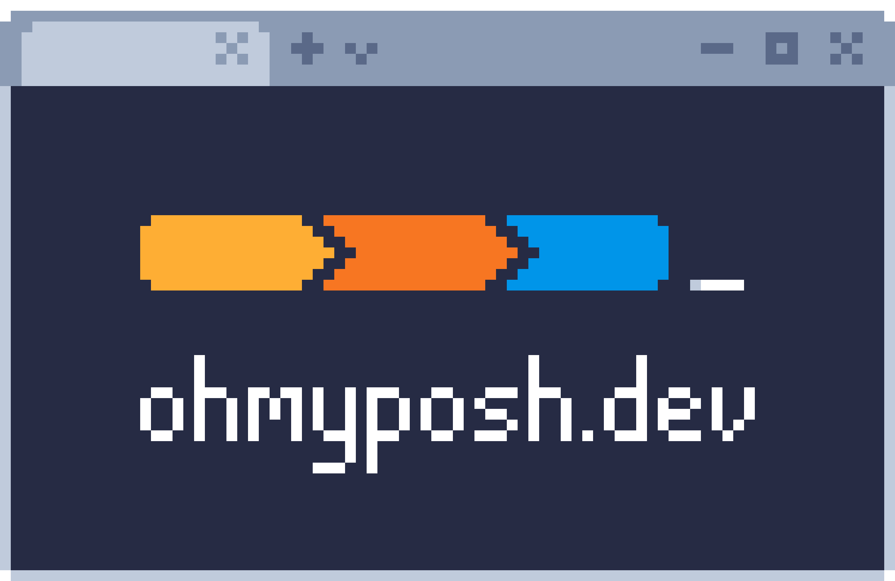

## Introduction
oh-my-posh is a cross platform, highly customizable and extensible prompt theme engine.

## Installation

```pwsh
winget install JanDeDobbeleer.OhMyPosh
```

## Setup

* Download [pywal.omp.json](pywal.omp.json)
* Add this line to your $PROFILE file:

```pwsh
oh-my-posh init pwsh --config "{write your path to  the pywal.omp.json here}" | Invoke-Expression
```

## Cache for speed

include this in your PROFILE.ps1:

```pwsh

$cacheDir = "$HOME/.cache/powershell"
if (-not (Test-Path $cacheDir)) {
    New-Item -ItemType Directory -Path $cacheDir -Force | Out-Null
}

# --- Oh My Posh Cache ---
$ompCache = "$cacheDir/oh-my-posh.ps1"
$ompConfig = "$HOME\.config\oh-my-posh\pywal.omp.json"

if (-not (Test-Path $ompCache) -or ((Get-Item $ompConfig).LastWriteTime -gt (Get-Item $ompCache).LastWriteTime)) {
    oh-my-posh init pwsh --config $ompConfig | Set-Content -Path $ompCache -Encoding utf8
}
. $ompCache
```

## ⭐ Show Some Love

If you enjoy this collection, consider leaving a **star**. It helps others discover it and motivates adding more!

<div align="center">

[](https://github.com/Somrat10369/Windows-11-Productive-Rice-Configs)

</div>

---
