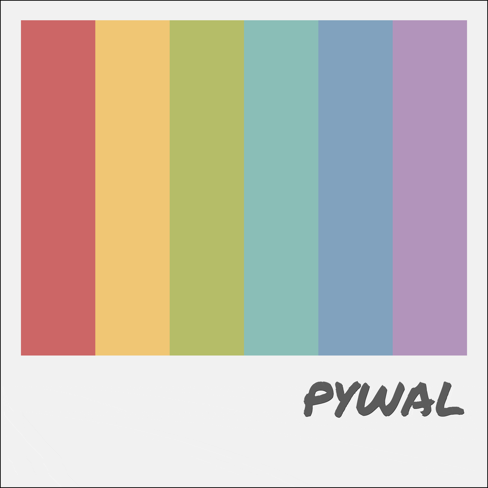
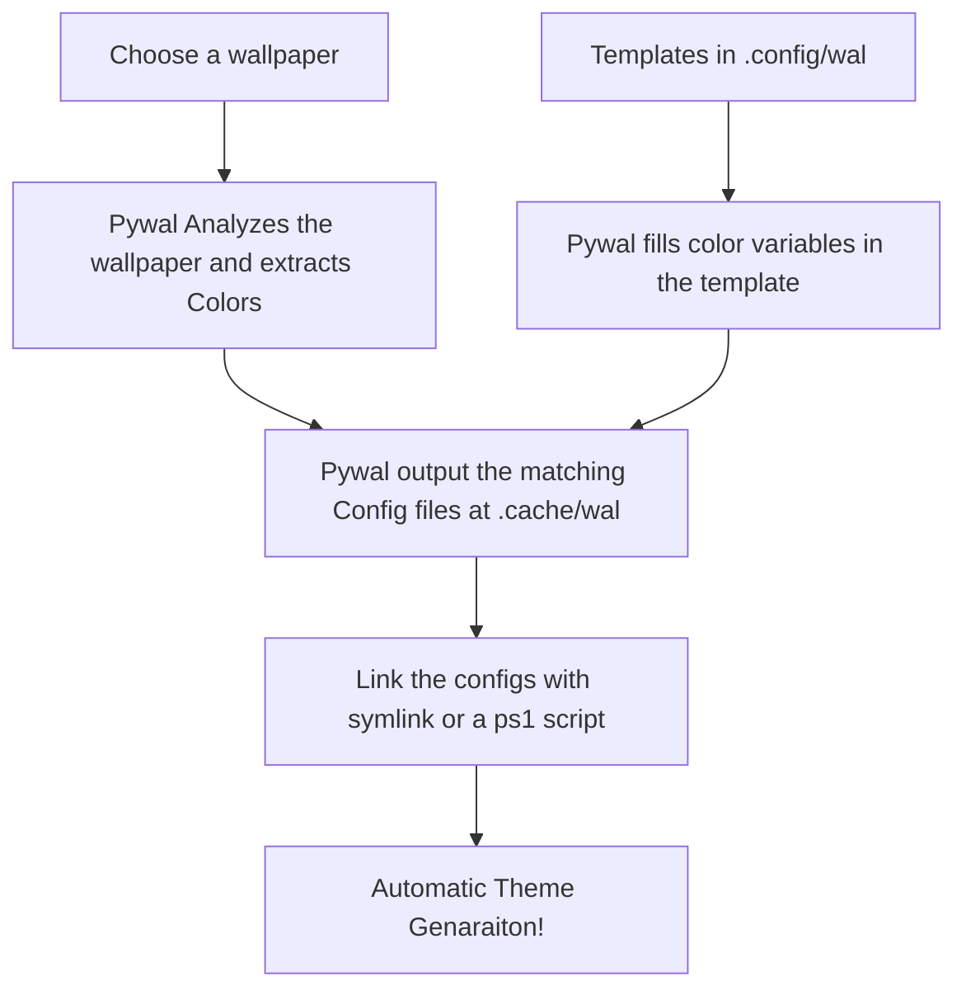

## Introduction



Pywal is a Python command-line tool that generates a color palette from the dominant colors from your wallpaper.

> Since dylanaraps/pywal was archived on Apr 26, 2024, eylles/pywal16 is the de facto successor — and notably, pip install pywal on PyPI now serves pywal16

## Installation

You need python and go isntalled:

* Python: `pip install pywal16`
* Go: `go install github.com/thefryscorer/schemer2@latest`

## Setup

* Put the templates in `C:\Users\{Username}\.config\wal\templates\`
* You could run a PowerShell registry watcher But I prefer using YASBs Run After Hook with the wallpaper widget [with Linking ps1 script](../Yasb/scripts/sync-terminal.ps1):

```yaml
      run_after:
        - "wal --backend schemer2 -s -t -e -q -n -i {image}"
```

## Workflow



The custom templates are in [`Pywal/templates`](../Pywal/templates/).

> They include opinionated application settings and styling, not just color placeholders.

**Back up your existing configuration files before using them, and review each template before copying it into `~/.config/wal/templates/` so you do not overwrite settings you want to keep.**
## ⭐ Show Some Love

If you enjoy this collection, consider leaving a **star**. It helps others discover it and motivates adding more!

<div align="center">

[](https://github.com/Somrat10369/Windows-11-Productive-Rice-Configs)

</div>


