

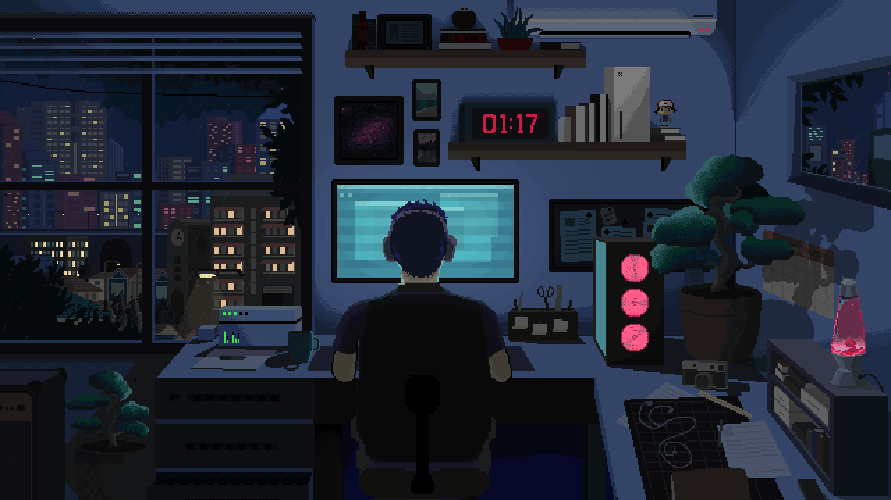

<strong>A personalized Windows setup built around productivity, keyboard-driven workflows, and a cohesive desktop aesthetic.</strong>
Window management, shell customization, terminal tooling, browser styling, and dynamic theming — collected in one place.

    

## Showcase

A look at the desktop and the applications that make up the setup.

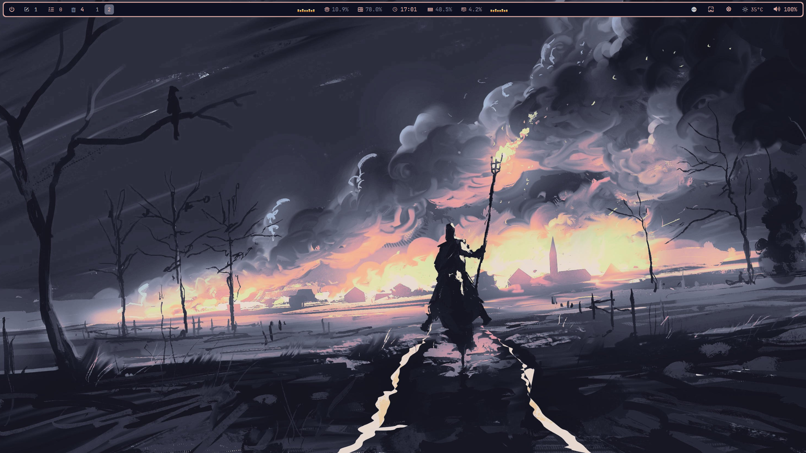
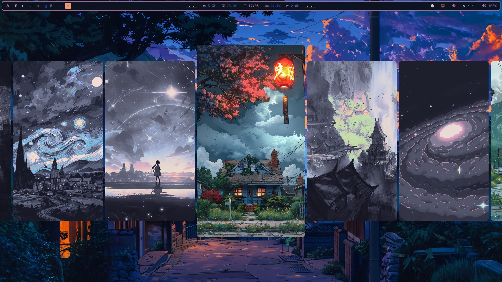

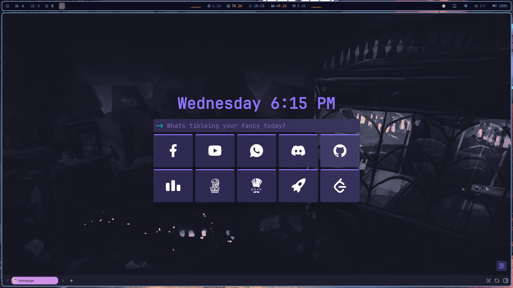
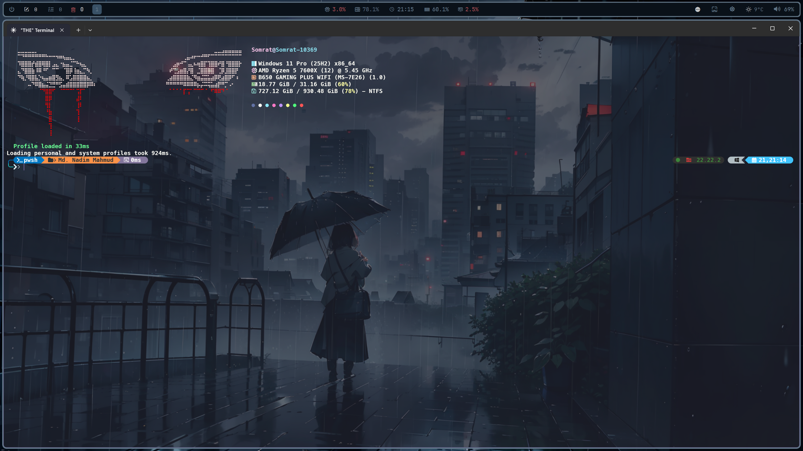

<strong>More screenshots</strong>

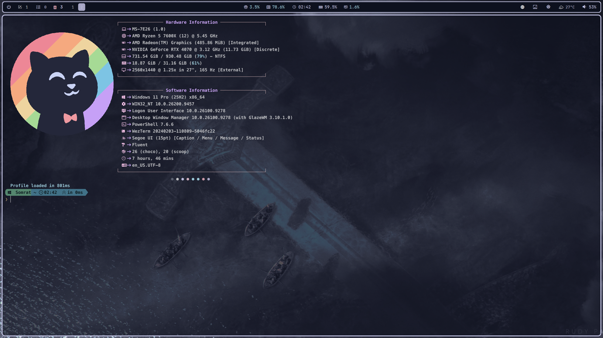

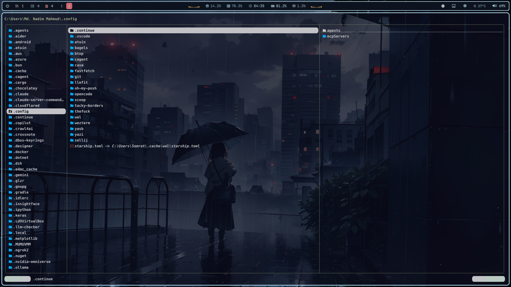

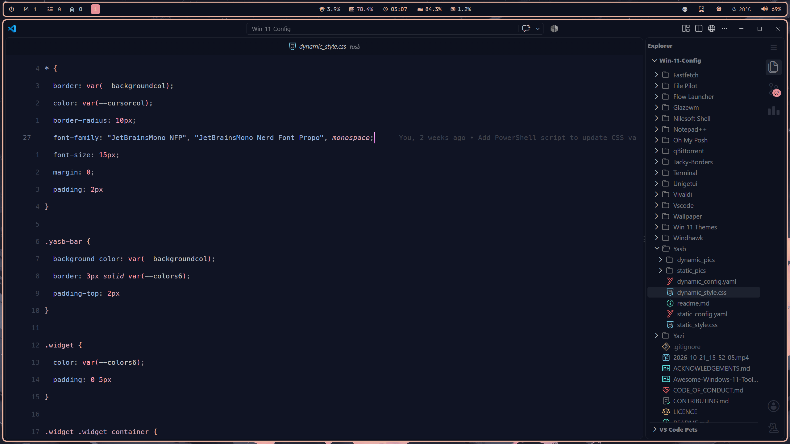
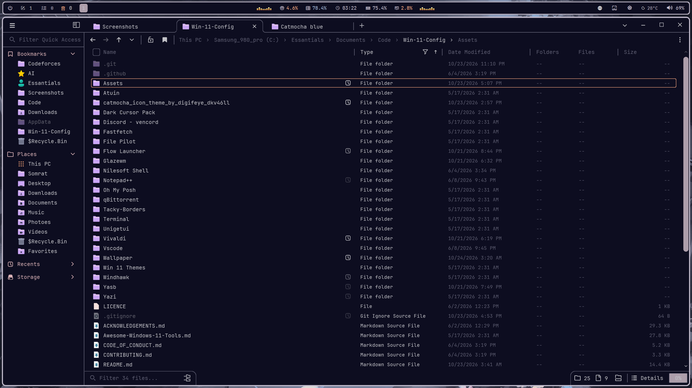
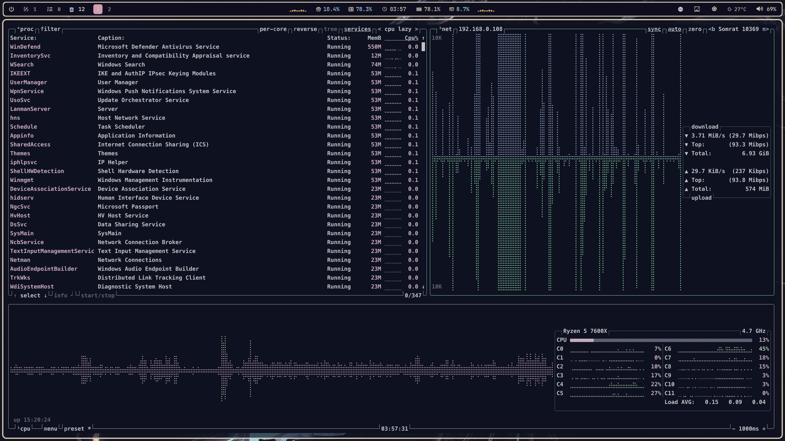
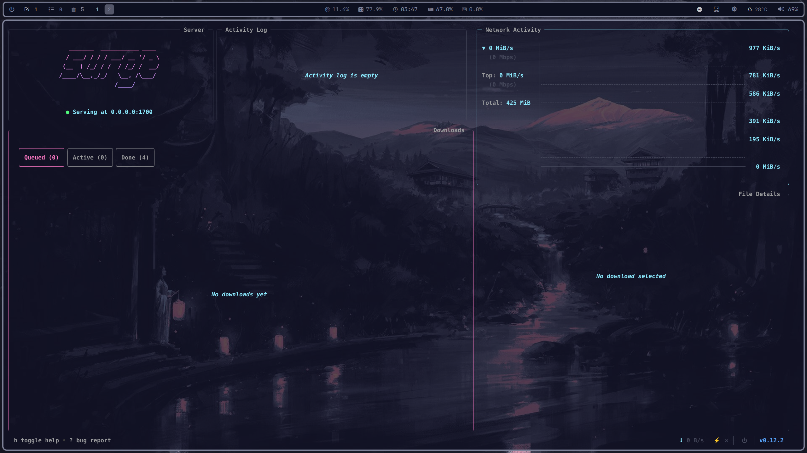

## What this repository is

This is my personal collection of Windows customization files, application configurations, and tools. It aims to reduce friction in everyday workflows, provide more keyboard control, and create a consistent visual style across the desktop.

- **Window management:** GlazeWM and keyboard-driven workflows.
- **Desktop interface:** YASB, Windhawk, Nilesoft Shell, and Tacky-Borders.
- **Terminal environment:** WezTerm, PowerShell, Oh My Posh, Atuin, and Fastfetch.
- **Applications:** Vivaldi, VS Code, Flow Launcher, File Pilot, and Yazi.
- **Theming:** Pywal, wallpapers, and a dark cursor pack.
- **Discovery:** A separate collection of useful Windows tools and utilities.

This is a collection of configurations, not a one-click installer. Each application has its own setup requirements, and components can be used independently.

## Configurations

Browse the directories below for each component's configuration and documentation.

| Component | What to explore |
|---|---|
| [GlazeWM](Glazewm/) | Tiling window management and keyboard-driven workflows |
| [YASB](Yasb/) | Custom desktop bar |
| [Windhawk](Windhawk/) | Windows interface modifications |
| [Nilesoft Shell](Nilesoft%20Shell/) | Context-menu customization |
| [Tacky-Borders](Tacky-Borders/) | Window-border customization |
| [Vivaldi](Vivaldi/) | Browser appearance and interface styling |
| [WezTerm](Wezterm/) | Terminal configuration and shell workflow |
| [Oh My Posh](Oh%20My%20Posh/) | Shell prompt styling |
| [Atuin](Atuin/) | Shell history workflow |
| [Fastfetch](Fastfetch/) | System information display |
| [Pywal](Pywal/) | Dynamic color palette and theming |
| [Flow Launcher](Flow%20Launcher/) | Application launcher |
| [File Pilot](File%20Pilot/) | File-management workflow |
| [Yazi](Yazi/) | Terminal file manager |
| [VS Code](Vscode/) | Editor configuration |
| [Wallpaper](Wallpaper/) | Desktop wallpapers |
| [Dark Cursor Pack](Dark%20Cursor%20Pack/) | Cursor theme assets |

Most application directories include their own README with component-specific installation, configuration, keybinding, and troubleshooting details. Start there rather than treating this page as a second manual.

## Dynamic theming with Pywal

The [Pywal configuration](Pywal/) is part of the theming workflow, bringing wallpaper-derived colors into supported parts of the setup through templates and application styling. The aim is a cohesive desktop without manually editing every application's colors whenever the visual theme changes. See the Pywal directory for the actual templates and setup details.

## Useful Windows tools

The separate **[Awesome Windows 11 Tools](Awesome-Windows-11-Tools.md)** list collects additional software worth exploring. Use it as a discovery list, not as a requirement to install everything here.

## Getting started

1. **Browse before copying.** Choose the components you actually want.
2. **Read the component documentation.** Check prerequisites, paths, dependencies, and installation instructions.
3. **Back up existing configurations.** Replacing settings can overwrite your current setup.
4. **Apply changes incrementally.** Configure one component at a time to isolate problems.
5. **Adapt rather than blindly copy.** Some paths and settings may need changes for your machine.

These files reflect my own environment. Your setup may require different dependencies or adjustments.

## Contributing

Suggestions and corrections are welcome. See [CONTRIBUTING.md](CONTRIBUTING.md) before opening a contribution. For security-related reports, refer to [SECURITY.md](SECURITY.md).

## License

See [LICENCE](LICENCE). Individual applications, themes, fonts, and third-party assets may have their own licenses; check the relevant upstream projects before redistributing them.

---
## ⭐ Show Some Love

If you enjoy this collection, consider leaving a **star**. It helps others discover it and motivates adding more!

  <picture>
    <source srcset="https://raw.githubusercontent.com/nordtheme/assets/main/static/images/elements/separators/iceberg/footer/dark/spaced.svg?sanitize=true" width="100%" media="(prefers-color-scheme: light), (prefers-color-scheme: no-preference)" />
    <source srcset="https://raw.githubusercontent.com/nordtheme/assets/main/static/images/elements/separators/iceberg/footer/light/spaced.svg?sanitize=true" width="100%" media="(prefers-color-scheme: dark)" />
    
  </picture>

