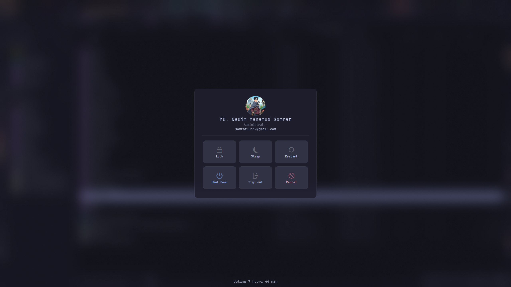
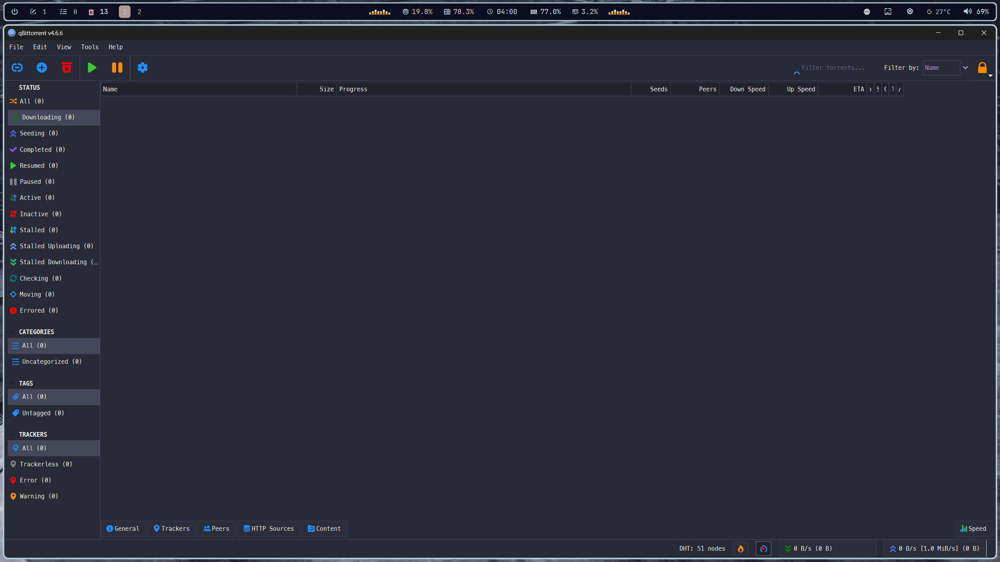
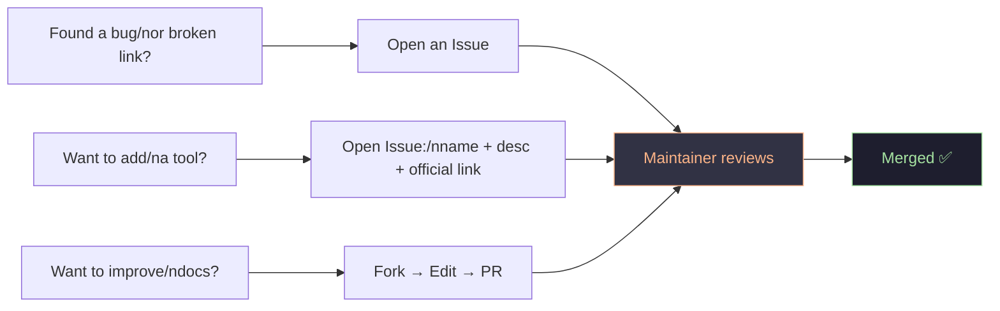

# Windows 11 Power User Setup & Config Collection

  

A complete Windows 11 productivity, customization, and developer setup featuring GlazeWM, YASB, Flow Launcher, Yazi, Windows Terminal, VS Code, PowerShell, Windhawk, themes, and 50+ recommended tools.

Turn Windows 11 into a fast, keyboard-driven workstation inspired by Linux workflows such as i3, Hyprland, tmux, and modern developer environments.

## 📸 Gallery

  

## 🤝 Contributing

1. **Report** — broken links, outdated tools, missing entries
2. **Suggest** — open an issue with name, description, and official link only
3. **Improve** — fix typos, add usage notes, update configs
> Link only to official sources. Follow the existing format.

---
## ❓ Frequently Asked Questions

- ### Is this a Windows 11 rice?

  Yes. This repository heavily customizes   Windows 11 with themes, GlazeWM, YASB,  Flow Launcher, terminal enhancements, and  workflow optimizations.

 

- ### Does this work on Windows 10?

  Most tools support Windows 10, though some  visual customizations are designed   specifically for Windows 11.

 

- ### Is this similar to Hyprland?

  Yes. The workflow is inspired by Linux  environments such as Hyprland, i3, tmux,   and Waybar.

 

- ### What are the main tools used?

  GlazeWM, YASB, Flow Launcher, Yazi,   Windows Terminal, PowerShell, VS Code,  Windhawk, Vivaldi, and Oh My Posh.

 

- ### Can I install everything with WinGet?

  Most applications can be installed using  WinGet or UniGetUI.

 

- ### Is this intended for developers?

  Yes. The setup focuses heavily on   developer productivity, terminal  workflows, automation, and keyboard-first  navigation.

 

- ### Can I use individual configs without copying everything?

  Absolutely. Every folder is designed to be used independently.

 

## Acknowledgements

See the full list of [contributors and projects here](ACKNOWLEDGEMENTS.md).

---

## 📜 License

Distributed under the **MIT License**.
Individual tools retain their own licenses — see each project's documentation.

---

---

[⬆ Back to top](#-win-11-config)

