# Vivaldi Configuration

A customized Vivaldi setup focused on a clean interface, practical navigation, and a personalized browsing experience.

## Contents

- [Gallery](#gallery)
- [Settings](#settings)
  - [General](#general)
  - [Address Bar](#address-bar)
  - [Panels](#panels)
  - [Search](#search)
  - [Start Page](#start-page)
  - [Startup](#startup)
  - [Tabs](#tabs)
  - [Web Pages](#web-pages)
  - [Window Appearance](#window-appearance)
  - [Bookmarks](#bookmarks)
  - [Downloads](#downloads)
  - [Keyboard](#keyboard)
  - [Mouse](#mouse)
  - [Network](#network)
  - [Performance](#performance)
  - [Privacy](#privacy)
- [Extensions](#extensions)
  - [Mtab](#mtab)
  - [Others](#others)

---

## Gallery

<b>Homepage</b>

.png)

Sidebar

## Settings

Screenshots of the configuration across Vivaldi's settings categories.

### General

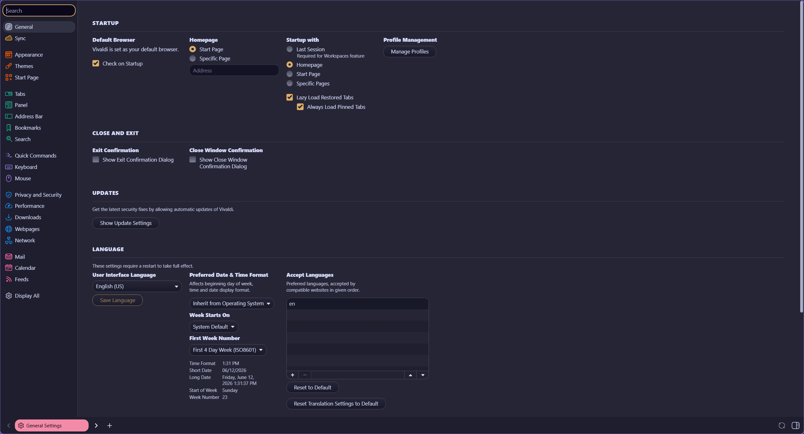

### Address Bar

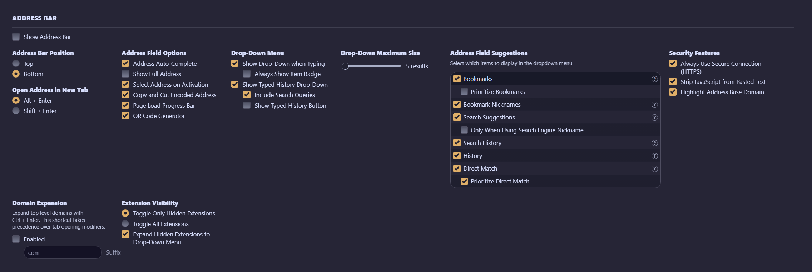

### Panels

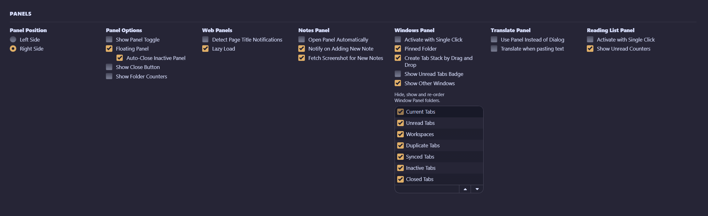

### Search

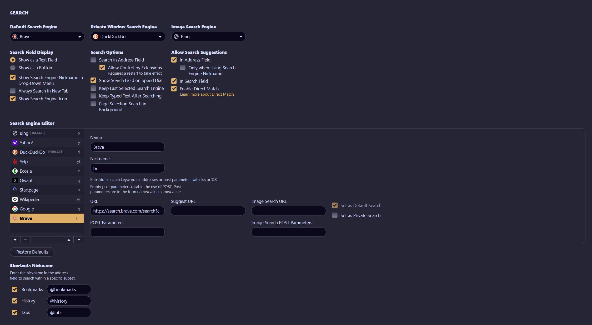

### Start Page

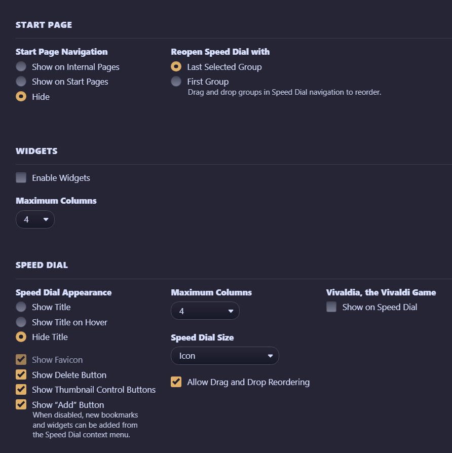

### Startup

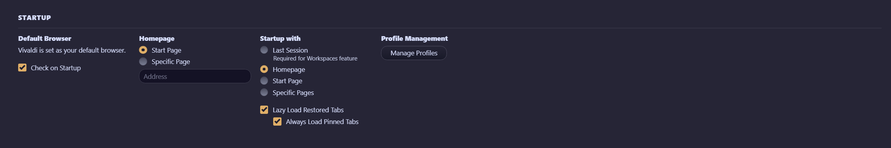

### Tabs

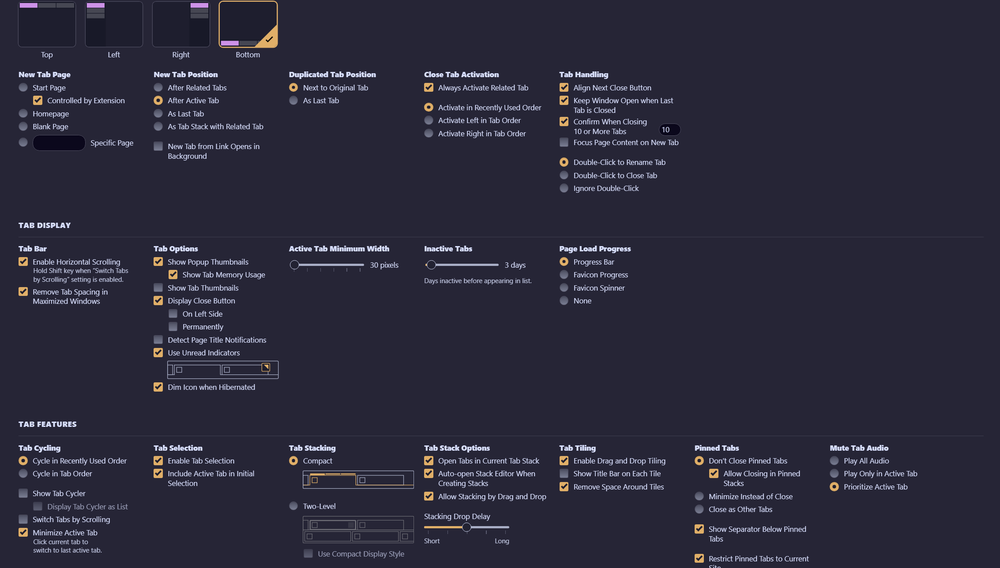

### Web Pages

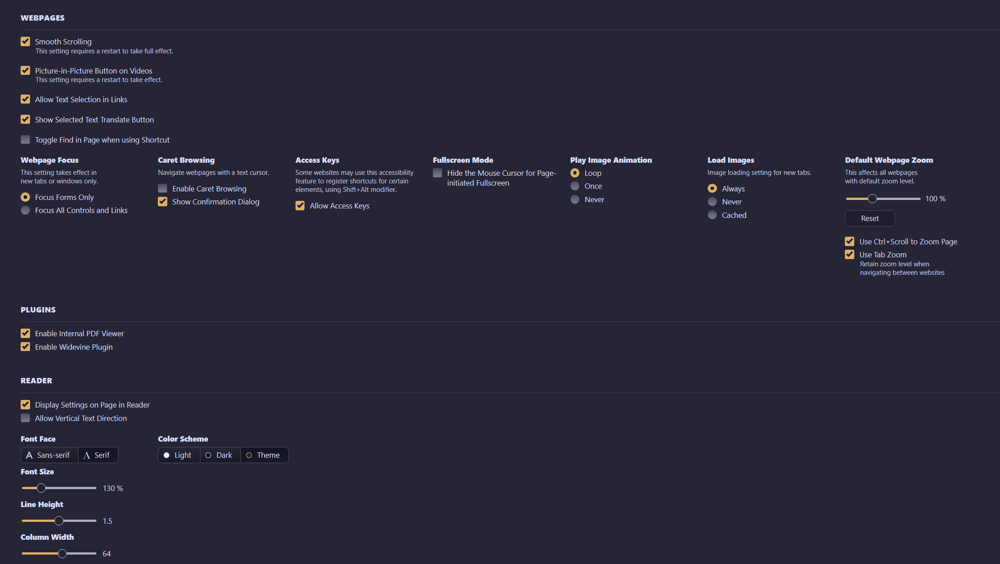

### Window Appearance

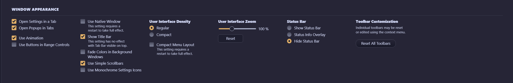

### Bookmarks

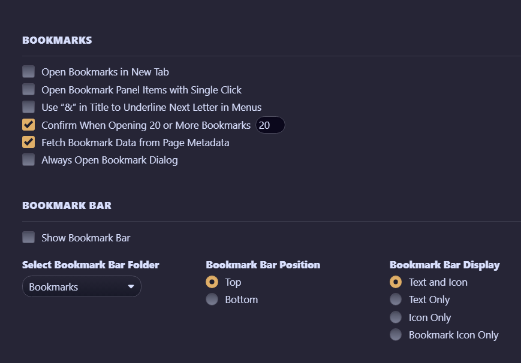

### Downloads

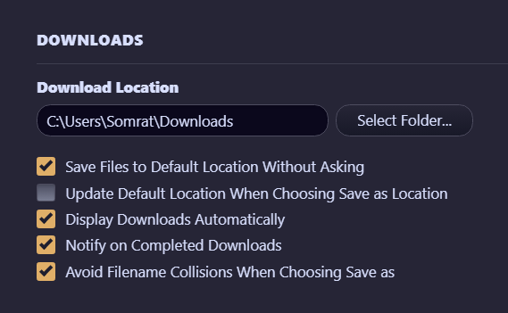

### Keyboard

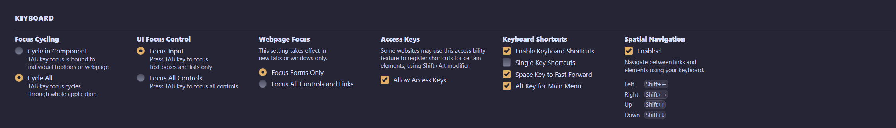

### Mouse

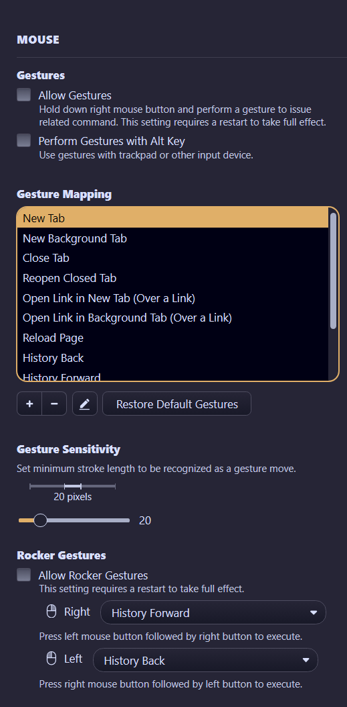

### Network

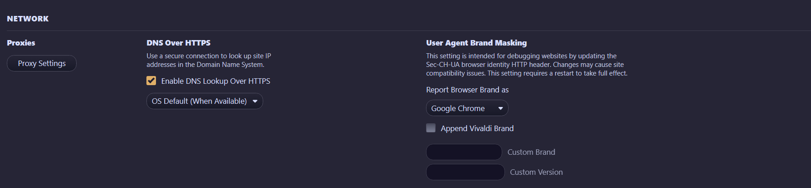

### Performance

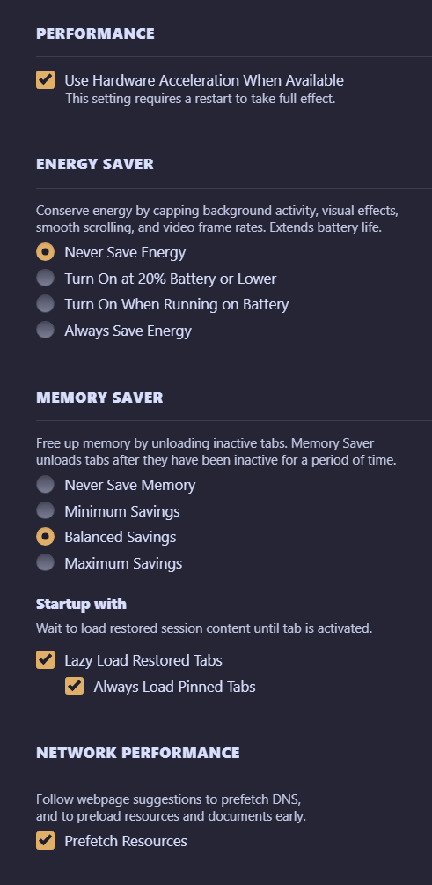

### Privacy

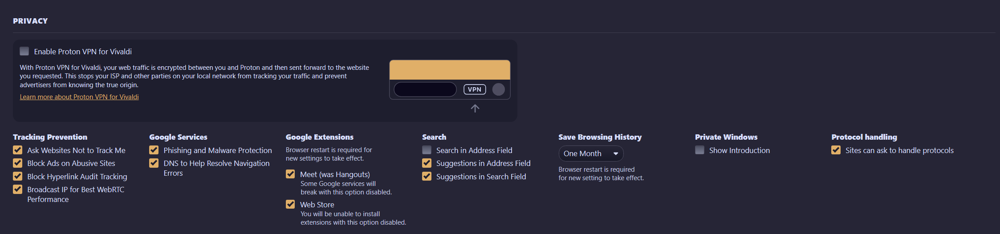

## Extensions

### Mtab

[Could be found here](https://chromewebstore.google.com/detail/mtab/fdaphilojaklgkoocegabckfanjoacjg)

The configuration used for this setup is available here:

- [Mtab settings](Extensions/mtab.json)

Import the configuration into Mtab to recreate the customized homepage.

### Others

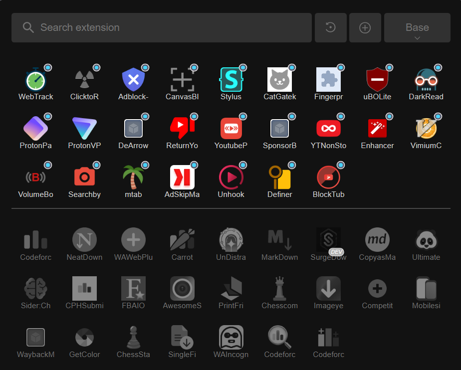

## ⭐ Show Some Love

If you enjoy this collection, consider leaving a **star**. It helps others discover it and motivates adding more!

