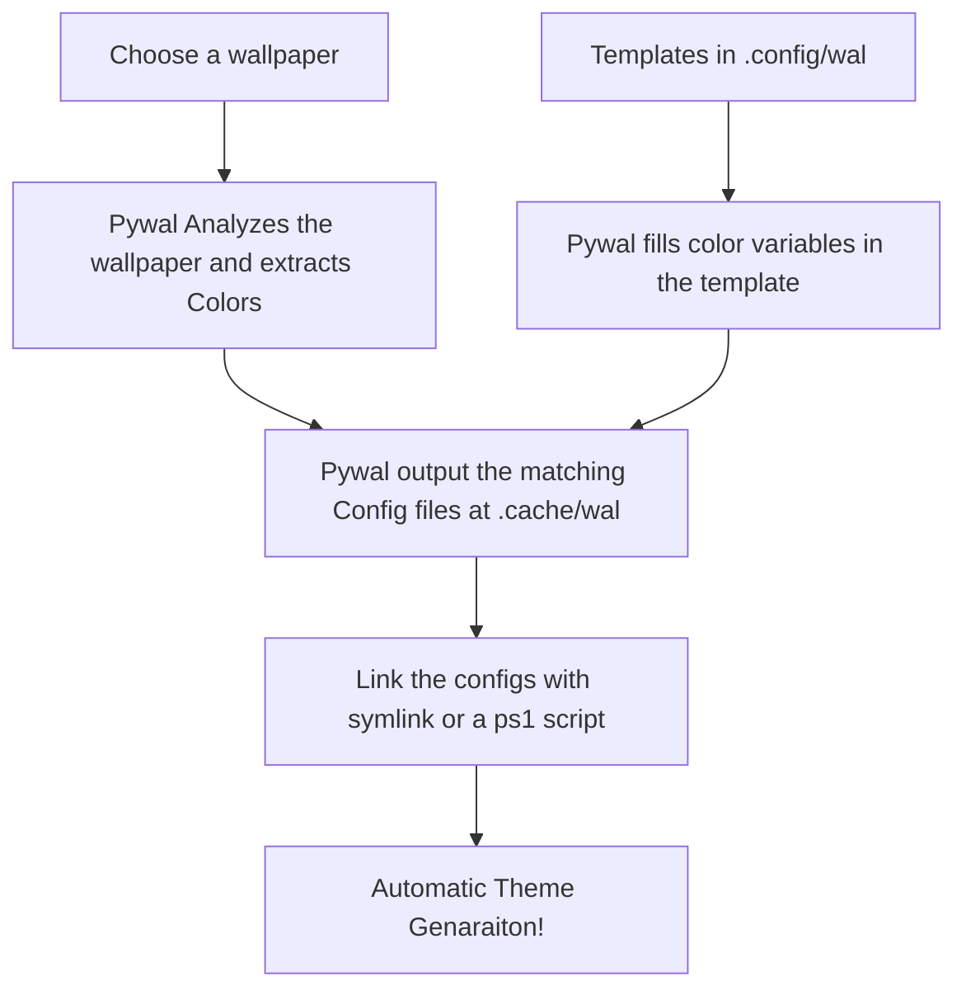

# Wallpaper Collection

## Workflow

The custom templates are in [`Pywal/templates`](../Pywal/templates/).

> They include opinionated application settings and styling, not just color placeholders.

**Back up your existing configuration files before using them, and review each template before copying it into `~/.config/wal/templates/` so you do not overwrite settings you want to keep.**

See the [Pywal setup notes](../Pywal/Readme.md) for the example script and YASB wallpaper hook.

## Gallery

## ⭐ Show Some Love

If you enjoy this collection, consider leaving a **star**. It helps others discover it and motivates adding more!

---
