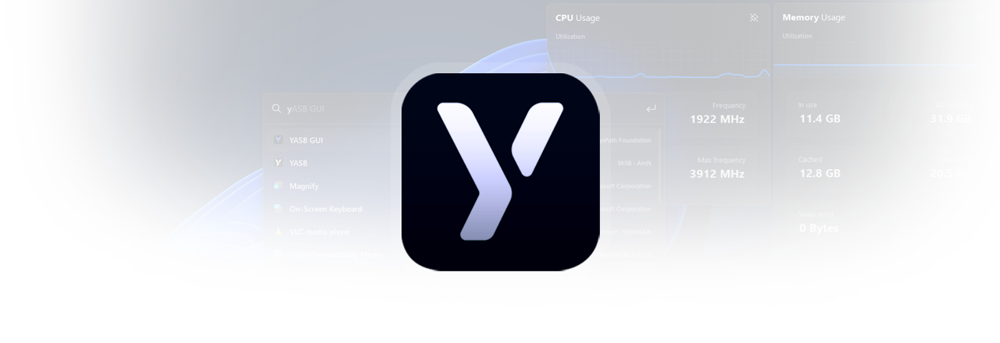
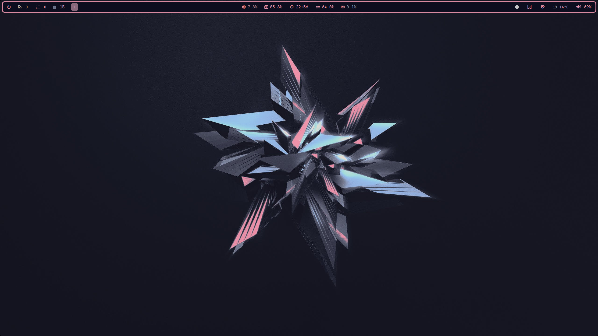
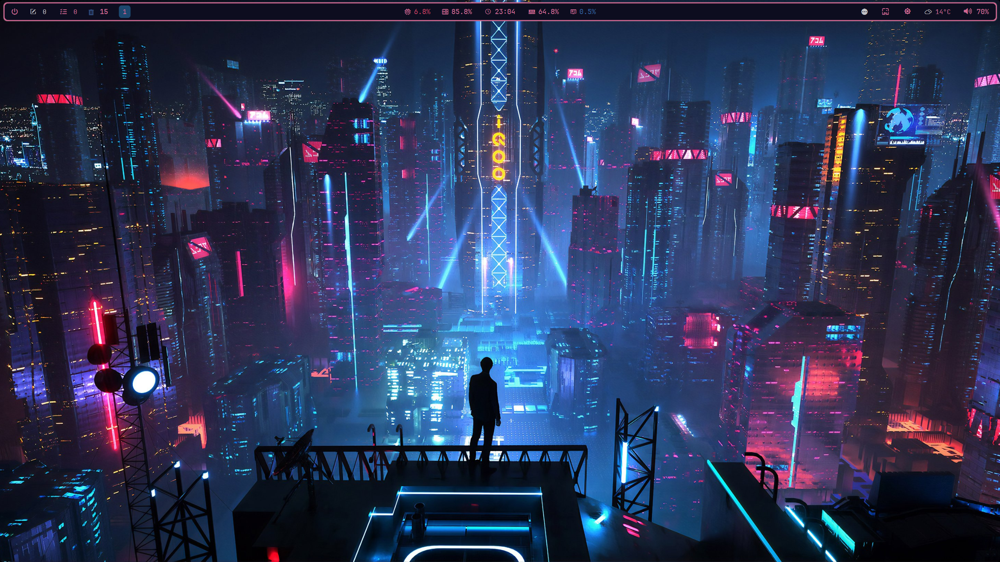
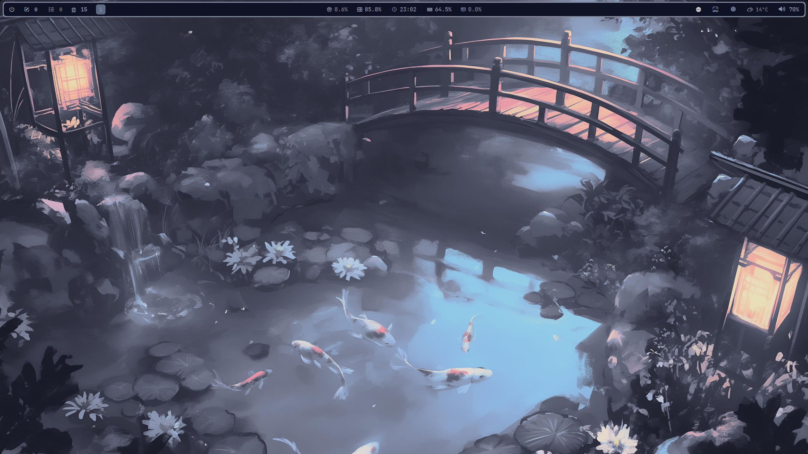
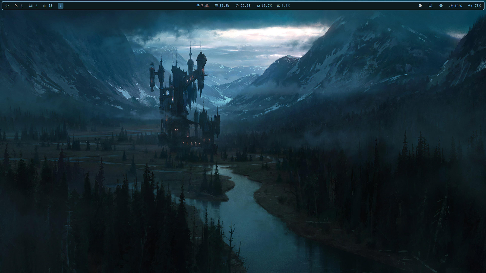
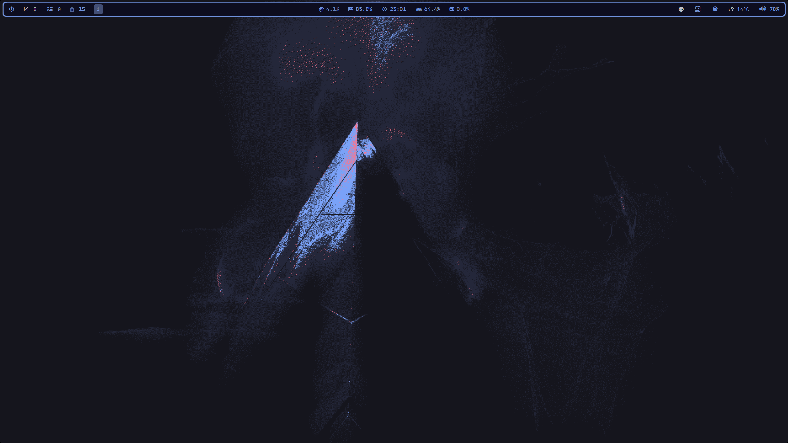
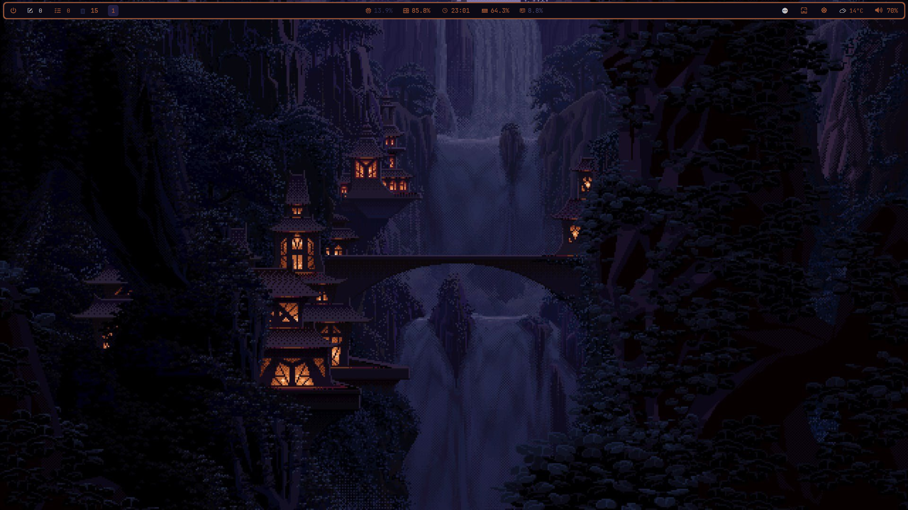
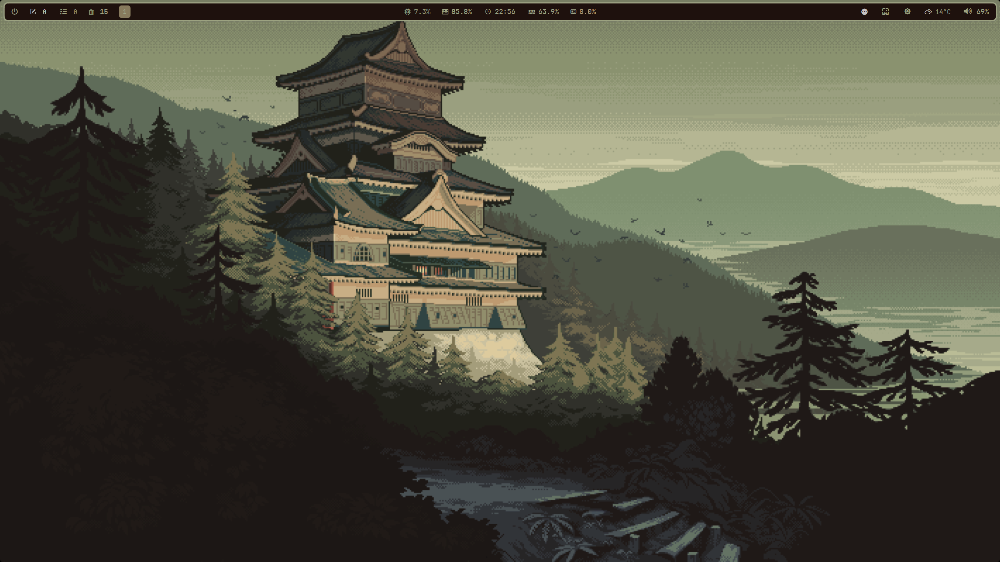
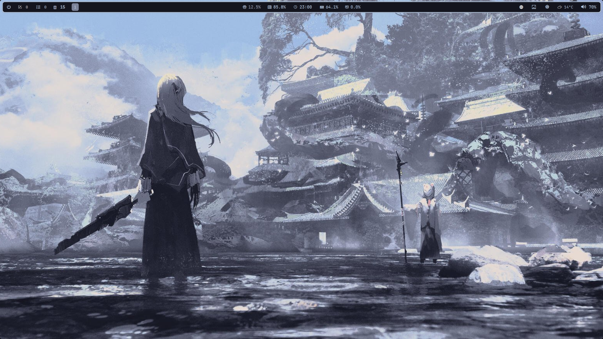
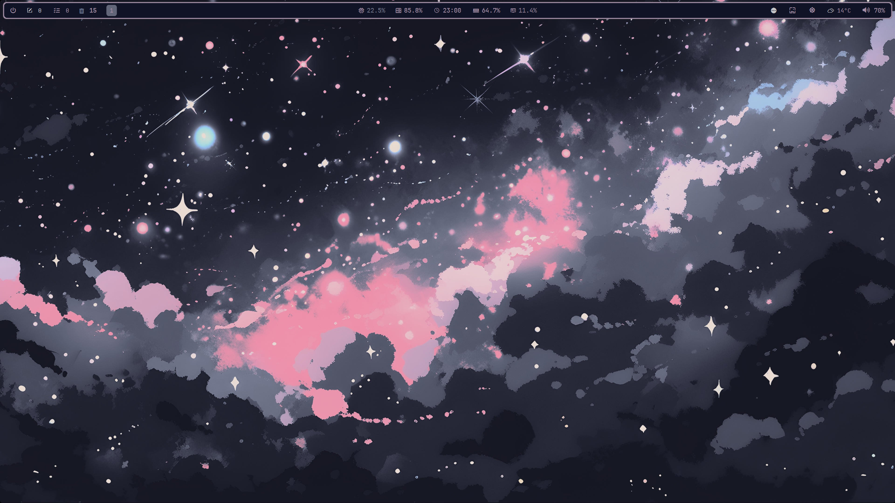

# [Glazing Mocha](https://github.com/amnweb/yasb-themes/tree/main/themes/c5ec9e92-6d12-408d-9b8c-1d68c86348ca)

**If you got rickrolled, ╰(*°▽°*)╯**

- To turn it of ... right click YASB bar and turn off the wifget named 'Prank'

## Gallery

## Setup

0. Install requirements!
1. Go to your yasb config directory, usually located at: `$HOME/.config/yasb`. Open `config.yaml` and replace and `{wallpaper_path}` with the path to your wallpaper. **Use 'Single quotes or yasb would crash'.**

## Optional

Check out my [GlazeWM config](https://github.com/Somrat10369/Windows-11-Productive-Rice-Configs/blob/main/Glazewm/config.yaml) for the recommended layout settings.Here are some [wallpapers](https://github.com/Somrat10369/Windows-11-Productive-Rice-Configs/tree/main/Wallpaper) that goes well with the bar.

If you face any issues with the theme, please open an issue [here](https://github.com/amnweb/yasb-themes/issues).

## Requirements

- [GlazeWM](https://github.com/glzr-io/glazewm/releases) — Tiling window manager
- [JetBrainsMono Nerd Font](https://github.com/ryanoasis/nerd-fonts/releases/latest/download/JetBrainsMono.zip) - For Nerd Glyphs & Icons
- [Pywal](https://github.com/eylles/pywal16)
 `pip install pywal16`
- [Cava](https://github.com/karlstav/cava)
 `winget install -e --id karlstav.cava`
- [Schemer2](https://github.com/thefryscorer/schemer2): `go install github.com/thefryscorer/schemer2@latest`

## ⭐ Show Some Love

If you enjoy this collection, consider leaving a **star**. It helps others discover it and motivates adding more!

